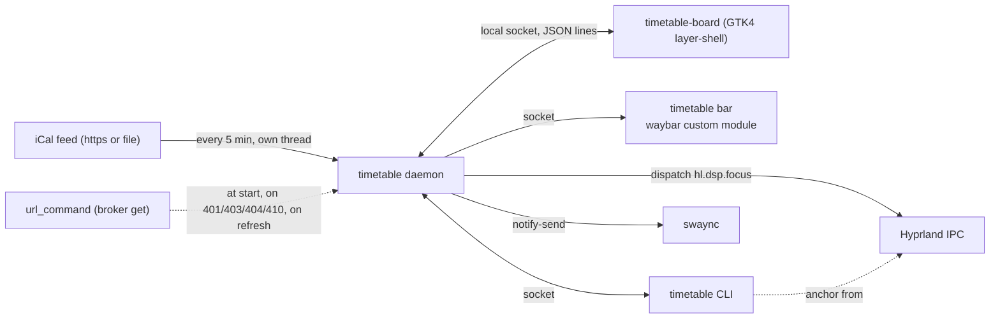

# Timetable design

Timetable is an agenda clock for a Wayland bar. The bar shows the next
event and the time; clicking it opens a drawer with the zones, the next
meeting and its Join button, the day strip and focus blocks. This document
is the reference for how it works and why. The README is the tour; this is
the spec.

## Goals

1. **The next thing at a glance.** The clock carries the next event and how
   urgent it is, so no calendar tab has to stay open.
2. **One click to the meeting.** Join switches to the meeting workspace and
   opens the link.
3. **Focus that respects the calendar.** A focus block is sized to the gap
   before the next event.
4. **The address is a secret.** The secret iCal address never leaves the
   daemon's memory.
5. **Cheap.** A redraw a minute, a read every 5 minutes, nothing in between.

## Non-goals

- **Not a calendar client.** No editing, no accepting invites, no OAuth.
  Right-click opens a real calendar app.
- **No do not disturb of its own.** Reminders are ordinary notifications;
  swaync decides whether they show.
- **One calendar.** One feed (or file) per daemon.

## Architecture



| Crate | Role |
|---|---|
| `bar-anchor` | Hyprland anchoring and panel placement. The same `Anchor` JSON as Roundhouse, Switchyard and Tannoy. |
| `timetable-core` | The model, the iCal reader, recurrence, links, agenda logic, fetching, config, protocol and the waybar reader. Pure where it can be. |
| `timetable` | The `timetable` binary: daemon, CLI, waybar module, Join and notifications. |
| `timetable-board` | The Linux drawer: GTK4 on `gtk4-layer-shell`, overlay layer, namespace `timetable`, keyboard exclusive while open. |

## Paths

| What | Where | Override |
|---|---|---|
| Config | `~/.config/timetable/config.toml` | `TIMETABLE_CONFIG_DIR` |
| User stylesheet | `~/.config/timetable/style.css` | `TIMETABLE_CONFIG_DIR` |
| Running focus block | `$XDG_STATE_HOME/timetable/focus.json` | `TIMETABLE_STATE_DIR` |
| Reminders sent | `$XDG_STATE_HOME/timetable/reminded.json` | `TIMETABLE_STATE_DIR` |
| Logs | `$XDG_STATE_HOME/timetable/daemon.log`, `board.log` | `TIMETABLE_STATE_DIR` |
| Last good agenda | `$XDG_CACHE_HOME/timetable/agenda.json` | `TIMETABLE_CACHE_DIR` |
| Socket | `$XDG_RUNTIME_DIR/timetable/timetable.sock` | `TIMETABLE_RUNTIME_DIR` |
| Daemon lock | `$XDG_RUNTIME_DIR/timetable/daemon.lock` | `TIMETABLE_RUNTIME_DIR` |

The runtime directory is mode 0700, the socket 0600, and the state and
cache files are written 0600 through a temporary file. The daemon holds an
`flock` on the lock file for its lifetime: two bars (one per monitor) start
`timetable bar` at the same moment, and the loser exits instead of
unlinking the winner's socket. The cache holds expanded events (titles,
times, links) and when they were read, never the address; it is used at
start when it is under a week old, so the bar has an agenda before the
first read finishes.

## Reading the calendar

The source is the first of `calendar.file`, `calendar.url` and
`calendar.url_command` that is set. With none, the bar is a clock and the
agenda is empty.

`url_command` runs with `sh -c` (a leading `~/` expanded), at most 20
seconds; the first non-empty line of its output is the address, and
`webcal://` becomes `https://`. On failure the error is its exit status and
the first line of its stderr. The daemon keeps the address in memory and
runs the command again only when a read answers HTTP 401, 403, 404 or 410,
on `timetable refresh`, or when `[calendar]` changes.

The fetcher thread reads the feed with ureq and rustls (gzip accepted),
`calendar.timeout` seconds, at most 96 MB, every `calendar.refresh`
minutes, or every minute while reads are failing. A failed read keeps the
previous agenda and records the error; errors never contain the address
(`fetch::redact` replaces it and any `private-<key>` path segment). After
a successful read the agenda is replaced, cached, and a running focus block
is shortened if a new event now cuts into it.

## iCal handling

`ical::parse` unfolds lines (CRLF or LF, a leading space or tab continues
the line), splits each property into name, quoted parameters and value,
and decodes TEXT escapes. It collects top-level `VEVENT`s only:
`VTIMEZONE` blocks are skipped (zones come from their names) and so is
anything nested in an event (a `VALARM` has its own `DESCRIPTION` and
`SUMMARY`). The description is searched for a link and then dropped.

| Value | Read as |
|---|---|
| `VALUE=DATE` | An all-day date, from local midnight to local midnight |
| `...Z` | UTC |
| `TZID=America/Chicago` | That IANA zone (chrono-tz, aliases like `Europe/Kiev` included) |
| `TZID="Central Standard Time"` | A Windows name, mapped to IANA |
| `TZID=/prefix/America/Chicago` | The IANA name at the end |
| Unknown `TZID`, or none | Floating: the local zone |

`expand::expand` places every event in time for a window (`calendar.past_days`
back to `calendar.future_days` ahead, local midnights):

- `RRULE` goes through the `rrule` crate. `UNTIL` is taken out of the rule
  first and turned into a UTC instant (a `Z` time as is, a date as the end
  of that day in the series' zone, a local time in the series' zone),
  because the crate insists on UTC and feeds do not always comply. A rule
  that ends before it starts yields only `DTSTART`. A rule the crate
  refuses shows once, at `DTSTART`, and is counted in the log. Walking a
  rule stops at the window's end (and after 50,000 steps).
- `RDATE` adds starts; `EXDATE` (several per line, several lines) removes
  them by instant, and a date-valued `EXDATE` removes that local day.
- An event with `RECURRENCE-ID` is an instance on its own: the master's
  occurrence at that original start is removed, and the instance is placed
  at its own `DTSTART` unless it is cancelled or declined. Missing fields
  (title, location, link) come from the master.
- `STATUS:CANCELLED` drops the event (or the instance).
- **Declined:** an `ATTENDEE` whose address is the owner's with
  `PARTSTAT=DECLINED` drops the event (or the instance; the rest of the
  series stays). The owner is `calendar.owner`, else the calendar id in a
  Google address (`/ical/<id>/private-...`, percent-decoded), else the
  feed's `X-WR-CALNAME` when it contains `@`.
- Length: `DTEND` minus `DTSTART`, else `DURATION`, else zero; all-day
  events in whole days (at least one), so a DST change does not shift them.

Only occurrences overlapping the window are kept, sorted by start. A
12 MB feed with about 3,000 events parses in about 25 ms and expands in a
few.

## Meeting links

`links::find` looks, in order, for a meeting URL in the location, then
Google's `X-GOOGLE-CONFERENCE`, then a meeting URL in the description,
then a location that is a bare URL (kind `link`). A location link wins
over Google's own conference because an invite with a pasted Zoom link
often also gets an automatic Meet. Meeting URLs are recognized by host:

| Kind | Hosts |
|---|---|
| `zoom` | `zoom.us`, `*.zoom.us`, `zoomgov.com` with `/j/`, `/my/`, `/w/` or `/s/` |
| `meet` | `meet.google.com/<code>` |
| `teams` | `teams.microsoft.com`, `teams.live.com` meeting paths |
| `slack` | `*.slack.com` paths containing `huddle` |
| `webex` | `*.webex.com` |
| `whereby` | `whereby.com` |

A URL ends at whitespace, `<`, `>`, quotes or `]`, and loses trailing
punctuation.

## The bar

`timetable bar` subscribes to the daemon and prints a waybar JSON line
whenever it changes. If the daemon is not running it starts one (detached,
in its own session), at most every 10 seconds, and meanwhile prints the
clock alone with class `offline`, retrying every 2 seconds.

The daemon's ticker wakes at the next minute boundary, or the next second
while a focus block runs, and at least every 2 seconds to check the config.
Each wake recomputes the line from memory and sends it only if it changed.

The state is `agenda::status`, first match wins:

| State | When | Text |
|---|---|---|
| `now` | A timed event started less than `bar.now_minutes` (5) ago | `icon_now Standup · Join` (`· now` without a link) |
| `focus` | A focus block is running | `icon_focus Focus 23:14` |
| `offline` | A calendar is set but has never been read | the clock with a dim `icon_offline` |
| `soon` | The next timed event starts within `bar.soon_minutes` (10) | `icon_event Standup in 7m` |
| `in` | A timed event is running | `icon_in Standup · 9m left` |
| `next` | The next timed event starts within `bar.next_minutes` (60) | `icon_event Standup in 34m` |
| `free` | Otherwise | `free until 14:00` when an event is left today and `bar.free_until`, else the clock alone |

Then `bar.separator` and the clock (`clock.format` in the local zone,
wrapped in `<span color>` when `bar.clock_color` is set). Minutes round up:
at 12:53:00 a 13:00 start is "in 7m". Titles are cut to `bar.max_chars` at
a word boundary. All-day events never set a state.

A meeting Join opened is never `soon` or `now`: joined early it counts
down calmly as `next`, and from its start it is `in`. The daemon keeps the
joined keys (`uid@start`) in memory, pruned a day after the start, so a
restart forgets them.

The class is a list: the state, `pulse` with `now`, and `stale` when the
agenda is older than three refresh intervals (at least 15 minutes), which
also puts the dim `icon_offline` before the clock. `alt` is the state. The
tooltip lists what is left today, a running focus block, the zones
(`Chicago 12:50 CST · EET 20:50 · GMT 18:50`) and the agenda's age or the
last error. Text and tooltip are escaped for Pango markup.

## Join

`timetable join` (middle-click), the drawer's Join button and `j`, and a
reminder's Join button all ask the daemon. The target is the event named by
key (`uid@start`, from the drawer and reminders), else `agenda::join_target`:
a timed event with a link that is running or starts within
`bar.soon_minutes`, the one about to start first and then the latest
started; else the next one today with a link.

The daemon closes the drawer first if it is open (while a layer surface
holds the keyboard exclusively, Hyprland keeps its workspace focused and
undoes the switch) and waits 450 ms. Then, when `join.workspace` is set
and Hyprland's socket exists, it writes `dispatch <join.dispatch>` to
Hyprland's IPC socket, with `{workspace}` replaced by the workspace (bare
when it is a number, a quoted Lua string otherwise); the default is the
Lua config's `hl.dsp.focus({ workspace = 2 })`. Last it runs
`sh -c '<join.opener> "$1"' timetable <link>` detached and marks the event
joined (see the bar). `--dry-run` only reports the event and link.

## Focus blocks

`timetable focus start|stop|toggle` (and the drawer's button and `f`).
`agenda::focus_plan` starts now and ends `focus.lead` (2) minutes before
the next timed event today, or after `focus.minutes` (50) when nothing else
is on today, capped at `focus.max` when that is set, and rounded down to a
whole minute. A block shorter than `focus.min` (5) is refused with the
reason.

The block is `{"start":..,"end":..}` in `focus.json`, so a restart keeps it.
A new event read later that starts inside the block (after its first
`lead` minutes) pulls its end in to `lead` minutes before that event. When
the block ends the daemon sends "Focus block over" with the next event (if
one starts within the hour) and deletes the file; a block that ended more
than 2 minutes ago (the machine slept) ends silently.

## Reminders

For every timed occurrence and every `reminders.minutes` value (5 and 1),
a reminder is due from `start - minutes` for 90 seconds. Each wake sends
the due ones not sent yet with `notify-send --app-name=Timetable
--urgency=normal`: "Standup in 5 min", "13:00 to 13:15 · Zoom", and a Join
button when the event has a link. Sent keys (`uid@start#minutes`) go to
`reminded.json` and are pruned a day after the event, so a restart never
repeats one. A reminder missed by more than 90 seconds (the machine slept
or the daemon was down) is skipped, not sent late. Urgency stays normal so
swaync's do not disturb applies. A meeting already joined gets no more
reminders.

## Anchoring and the drawer

As in Tannoy: `timetable toggle` asks Hyprland's IPC socket for the cursor,
its monitor and the bar's layer surface (`bar.namespace`) while the cursor
is still on the clock, and sends the `Anchor` with the request. The drawer
covers the monitor with a transparent overlay surface, places the panel
next to the bar centered on the click (`bar_anchor::place`), and scales it
open from the click point. A click outside the panel or `Esc` closes it.
Without Hyprland, or with `--center`, it opens centered.

The drawer redraws every second while open. The day strip runs from
`day.start` to `day.end`, widened to whole hours that fit today's timed
events; free gaps of at least `day.min_gap` minutes are dashed, a running
focus block highlights its gap, past events dim, the running one is the
accent color and the next one amber. Copy link uses the Wayland clipboard;
the drawer stays resident, so the copy survives it closing.

## Theme

With `theme.from = "waybar"` the drawer reads waybar's `style.css` like
Tannoy does: the font, the bar's background and text colors, the first
module border, the first `:hover` background and every `@define-color`.
Only the RGB of the bar background is used and the alpha is forced to 1
(the panel itself is 0.97), so a transparent floating bar still gives an
opaque drawer. `accent` or `frost` becomes the accent; `green`, `yellow`,
`red` and `purple` become the free, soon, now and clock colors. Layers,
lowest first: the built-in `style.css`, the bar-derived tokens,
`~/.config/timetable/style.css`.

## Protocol

Newline-delimited JSON on the socket, one request per line, one reply per
request. Shapes follow Roundhouse's, Switchyard's and Tannoy's.

```json
{"cmd":"ping"}
{"cmd":"snapshot"}
{"cmd":"subscribe","kind":"bar"}
{"cmd":"subscribe","kind":"board"}
{"cmd":"toggle","anchor":{"monitor":"DP-2","edge":"bottom","x":2310,"y":1417,"width":2560,"height":1440,"reserved":[0,0,0,40],"center":false}}
{"cmd":"show","anchor":null}
{"cmd":"hide"}
{"cmd":"board_visible","visible":true}
{"cmd":"join","key":null,"dry_run":false}
{"cmd":"refresh"}
{"cmd":"focus","action":"start"}
```

Replies are `{"ok":true}` with optional `snapshot`, `version`, `message`
(what a command did) or `error`. A `board` subscription receives
`{"event":"snapshot","snapshot":{...}}` whenever the snapshot changes
(ignoring its time), plus `show`, `toggle` and `hide` events. A `bar`
subscription receives waybar lines, already formatted, only when they
change. When a toggle arrives and no drawer is subscribed, the daemon
starts `timetable-board` (next to `timetable`, else on `PATH`) and holds
the show until it subscribes.

The snapshot (`timetable status --json`) is `version`, `now`, `source`
(`none`, `url_command`, `url`, `file`), `events` (each `uid`, `title`,
`start`, `end`, `all_day`, `location`, `link`, `kind`), `fetched_at`,
`attempted_at`, `error`, `cached`, `focus`, `joined` (the keys of events
Join opened, left out when empty) and `config_error`. Times are
Unix seconds. It never contains the address.

## Config keys

| Key | Default | Meaning |
|---|---|---|
| `calendar.url_command` | `""` | Prints the address, run with `sh -c` |
| `calendar.url` | `""` | The address itself |
| `calendar.file` | `""` | A local `.ics` file; wins over the other two |
| `calendar.owner` | `""` | Your address, for declines; derived when empty |
| `calendar.refresh` | `5` | Minutes between reads |
| `calendar.timeout` | `60` | Seconds one read may take |
| `calendar.past_days` | `1` | Days back in the agenda |
| `calendar.future_days` | `14` | Days ahead in the agenda |
| `clock.format` | `"%a %b %-d  %H:%M"` | The bar clock, chrono strftime |
| `clock.zone` | `""` | Your IANA zone; empty reads `TZ`, then `/etc/localtime` |
| `clock.zones` | Chicago, EET, GMT | `[{ zone, label }]` for the drawer and tooltip |
| `bar.max_chars` | `24` | Longest event title in the bar |
| `bar.next_minutes` | `60` | `next` within this |
| `bar.soon_minutes` | `10` | `soon` within this; also Join's lookahead |
| `bar.now_minutes` | `5` | `now` for this long after a start |
| `bar.free_until` | `true` | "free until 14:00" while free |
| `bar.separator` | `"  "` | Between the event and the clock |
| `bar.clock_color` | `""` | Pango color for the clock |
| `bar.icon_event` | `"\U000F00ED"` | Before `next` and `soon` text |
| `bar.icon_now` | `"\U000F0567"` | Before `now` text |
| `bar.icon_in` | `"\U000F0849"` | Before `in` text |
| `bar.icon_focus` | `"\U000F051B"` | Before the focus countdown |
| `bar.icon_offline` | `"\U000F0164"` | Dim, before the clock when offline or stale |
| `bar.namespace` | `"waybar"` | The bar's layer-shell namespace |
| `join.workspace` | `"2"` | Workspace to switch to; empty stays put |
| `join.dispatch` | `"hl.dsp.focus({ workspace = {workspace} })"` | Hyprland dispatch |
| `join.opener` | `"xdg-open"` | Opens the link, its last argument |
| `reminders.minutes` | `[5, 1]` | Minutes before each timed event |
| `focus.minutes` | `50` | Block length on a free day |
| `focus.lead` | `2` | End this long before the next event |
| `focus.max` | `0` | Longest block; 0 is no limit |
| `focus.min` | `5` | Shortest block worth starting |
| `day.start` | `"08:00"` | Day strip and gaps start |
| `day.end` | `"18:00"` | Day strip and gaps end |
| `day.min_gap` | `15` | Shortest gap drawn as free |
| `drawer.width` | `420` | Panel width in logical pixels |
| `drawer.max_height` | `0.85` | Largest height as a fraction of the monitor |
| `drawer.gap` | `8` | Gap between the bar and the panel |
| `drawer.calendar_hint` | `"right-click the clock for the calendar"` | The footer's last words |
| `theme.from` | `"waybar"` | `waybar` or `none` |
| `theme.accent` | none | Overrides the accent color |
| `theme.font` | none | Overrides the font family |

Unknown keys, unknown zones and times that are not `HH:MM` are errors: the
defaults are used and the drawer and `timetable doctor` say what is wrong.
The daemon rereads the config within 2 seconds of a change, and a change to
`[calendar]` or `clock.zone` reads the calendar again.

## Keyboard

| Key | Action |
|---|---|
| <kbd>j</kbd> | Join the meeting on the card |
| <kbd>c</kbd> | Copy its link |
| <kbd>f</kbd> | Start or stop a focus block |
| <kbd>r</kbd> | Read the calendar now |
| <kbd>Esc</kbd> | Close |
